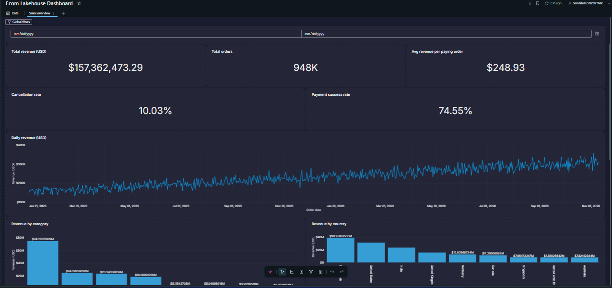
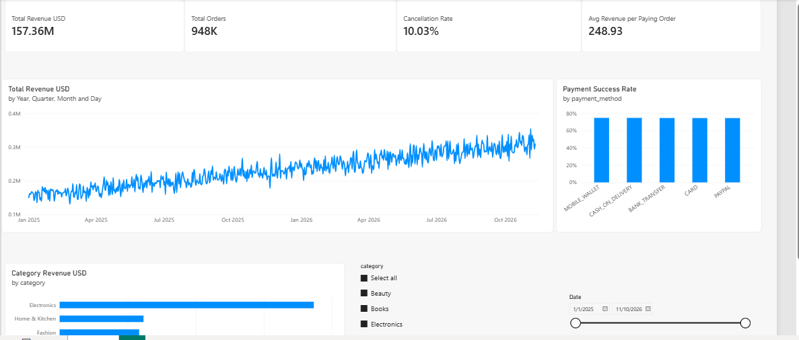
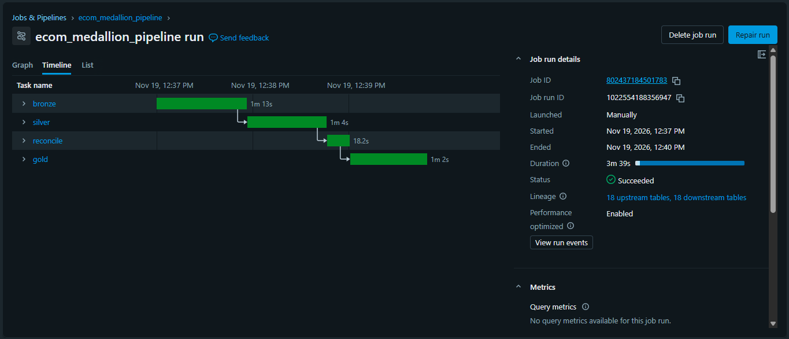
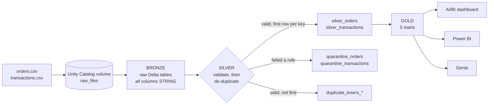
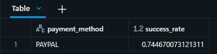
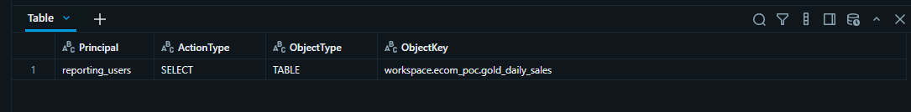

<div align="center">

# E-commerce Lakehouse on Databricks

**Bronze → Silver → Gold on Unity Catalog and Delta Lake, with AI/BI, Power BI and Lakeflow Jobs**


Hands-on Data Engineering Assessment · Instructor: **Lipton Ahammed** · Submission date: **19 November 2026**
Author: **Md. Rashedul Islam** · GitHub: [Rashedul023](https://github.com/Rashedul023)

</div>

---

## Contents

1. [Summary and results](#1-summary-and-results)
2. [Evidence screenshots](#2-evidence-screenshots)
3. [Architecture](#3-architecture)
4. [Trial workspace and environment](#4-trial-workspace-and-environment)
5. [Synthetic source files](#5-synthetic-source-files)
6. [Bronze: lossless ingestion](#6-bronze-lossless-ingestion)
7. [Silver: cleaning, validation and reconciliation](#7-silver-cleaning-validation-and-reconciliation)
8. [Gold: business models](#8-gold-business-models)
9. [Databricks AI/BI and Genie](#9-databricks-aibi-and-genie)
10. [Power BI](#10-power-bi)
11. [Lakeflow Job and security](#11-lakeflow-job-and-security)
12. [Limitations and fallbacks](#12-limitations-and-fallbacks)
13. [Repository structure](#13-repository-structure)
14. [How to reproduce](#14-how-to-reproduce)

---

## 1. Summary and results

### Business problem

An e-commerce company receives daily CSV extracts of orders and payments. The files contain null values, text in numeric fields, bad and future dates, mixed labels, duplicate records and payments that point to orders that do not exist. Sales reports built on them are not reliable.

This project keeps the raw evidence, cleans the data with explicit rules, and publishes documented metrics. Every raw row can be traced to one outcome.

### Results at a glance

| Area | Result |
|---|---|
| Source files | `orders.csv` and `transactions.csv`, 1,000,000 data rows each, synthetic |
| Bronze | 1,000,000 rows per table, all columns kept as text, source rows equal Bronze rows |
| Silver, orders | 948,000 accepted, 32,000 quarantined, 20,000 duplicate losers |
| Silver, transactions | 907,306 accepted, 73,311 quarantined, 19,383 duplicate losers |
| Reconciliation | Bronze = accepted + quarantined + duplicate losers, with no overlap, for both datasets |
| Gold | 5 tables with a stated grain and unique key, with table and column comments |
| BI | Databricks AI/BI dashboard and a Power BI report on the same Gold tables |
| Orchestration | Lakeflow Job: `bronze` → `silver` → `reconcile` → `gold` |

---

## 2. Evidence screenshots

All screenshots come from my own Databricks trial workspace and my own Power BI Desktop session.

### 2.1 Databricks AI/BI dashboard

<p align="center">
  
</p>
<p align="center"><em>Figure 1. AI/BI dashboard built on the Gold tables. KPI counters, a daily revenue trend, revenue by category and by country, and one shared date range filter.</em></p>

### 2.2 Power BI report

<p align="center">
  
</p>
<p align="center"><em>Figure 2. One-page Power BI report, Import mode, using the same measure definitions as the Databricks dashboard.</em></p>

### 2.3 Lakeflow Job

<p align="center">
  
</p>
<p align="center"><em>Figure 3. Lakeflow Job <code>ecom_medallion_pipeline</code>. Each task depends on the one before it, so Gold does not run after a failed upstream task.</em></p>

---

## 3. Architecture



| Layer | Tables | Purpose |
|---|---|---|
| Landing | volume `raw_files` | Source CSV files, unchanged |
| Bronze | `bronze_orders`, `bronze_transactions`, `bronze_load_log`, `bronze_dirty_inventory` | Raw evidence with audit columns |
| Silver | `silver_orders`, `silver_transactions`, `quarantine_*`, `duplicate_losers_*`, `silver_rules_matrix`, `silver_rule_counts`, `ref_fx_rates`, `recon_summary` | Typed, validated, explainable |
| Gold | `gold_order_revenue`, `gold_daily_sales`, `gold_revenue_breakdown`, `gold_payment_success`, `gold_top_customers` | Documented business measures |

Catalog: `workspace`. Schema: `ecom_poc`. Volume path: `/Volumes/workspace/ecom_poc/raw_files/`.

---

## 4. Trial workspace and environment

| Item | Value |
|---|---|
| Account | Own-email Databricks free trial (not Community Edition, not Free Edition) |
| Workspace host | `dbc-e9886eb3-63bc.cloud.databricks.com` |
| Cloud | AWS |
| ETL compute | Serverless notebooks |
| BI compute | Serverless Starter Warehouse (one warehouse, used only for reports) |
| Catalog and schema | `workspace`.`ecom_poc` |
| Git | Databricks Git folder linked to [`Rashedul023/databricks-medallion-lakehouse`](https://github.com/Rashedul023/databricks-medallion-lakehouse) |

<details>
<summary><b>Naming standard</b></summary>

Tables start with the layer, then the entity: `bronze_orders`, `silver_orders`, `gold_daily_sales`. Rejected rows go to `quarantine_<entity>`. Rows that lose a duplicate contest go to `duplicate_losers_<entity>`. Audit columns start with an underscore, for example `_row_id`. Notebooks are numbered in run order.

</details>

<details>
<summary><b>Why serverless for ETL and a small warehouse for BI, and how credits were kept low</b></summary>

Serverless notebooks need no cluster set-up and cost nothing while idle. The SQL warehouse gives dashboards and Power BI one governed query layer. To keep credit use low: one warehouse only, short auto-stop, no schedules, no parallel experiments, and compute stopped after each session.

</details>

<details>
<summary><b>Trial compared with Free Edition</b></summary>

The free trial is time-limited and gives a credit allowance (the assignment notes a 14-day window and up to $400 for eligible sign-ups) with a fuller workspace. Free Edition is a permanently free tier with smaller quotas and fewer features. This project uses the trial. See the official Databricks page for the current comparison.

</details>

---

## 5. Synthetic source files

| File | Columns | Data rows |
|---|---|---|
| `orders.csv` | order_id, customer_id, order_date, category, quantity, unit_price, order_status, country | 1,000,000 |
| `transactions.csv` | txn_id, order_id, payment_method, amount, currency, txn_status, txn_ts | 1,000,000 |

- Generator and dirty-data report: [`generator/`](generator/).
- File sizes and row counts are recorded in `bronze_load_log` (`source_bytes`, `source_data_rows`) and can be listed with `sql/01_setup.sql`.
- The two CSV files are not in Git.

### Dirty-data inventory

Measured from Bronze by `notebooks/02_profile.py` and stored in the table `bronze_dirty_inventory`.

<details open>
<summary><b>Orders</b></summary>

| Anomaly type | Field | Rows | % of file |
|---|---|---:|---:|
| null or blank | customer_id | 5,000 | 0.500 |
| null or blank | order_date | 3,000 | 0.300 |
| invalid date text | order_date | 3,000 | 0.300 |
| future date | order_date | 3,000 | 0.300 |
| non-numeric text | quantity | 4,000 | 0.400 |
| out of range | quantity | 3,000 | 0.300 |
| non-numeric text | unit_price | 4,000 | 0.400 |
| out of range | unit_price | 3,000 | 0.300 |
| invalid label | order_status | 2,000 | 0.200 |
| invalid label | country | 2,000 | 0.200 |
| case or space variant | category | 15,000 | 1.500 |
| case or space variant | order_status | 11,287 | 1.129 |
| case or space variant | country | 15,000 | 1.500 |
| duplicate key, extra rows | order_id | 20,000 | 2.000 |
| exact duplicate rows, extra | all columns | 10,000 | 1.000 |

</details>

<details open>
<summary><b>Transactions</b></summary>

| Anomaly type | Field | Rows | % of file |
|---|---|---:|---:|
| null or blank | order_id | 3,000 | 0.300 |
| orphan order_id | order_id | 10,000 | 1.000 |
| invalid label | payment_method | 2,000 | 0.200 |
| null or blank | amount | 4,000 | 0.400 |
| non-numeric text | amount | 4,000 | 0.400 |
| out of range | amount | 5,001 | 0.500 |
| invalid label | currency | 3,000 | 0.300 |
| invalid label | txn_status | 2,000 | 0.200 |
| null or blank | txn_ts | 3,000 | 0.300 |
| invalid timestamp text | txn_ts | 3,000 | 0.300 |
| future timestamp | txn_ts | 3,000 | 0.300 |
| case or space variant | payment_method | 11,344 | 1.134 |
| case or space variant | currency | 11,193 | 1.119 |
| case or space variant | txn_status | 11,317 | 1.132 |
| duplicate key, extra rows | txn_id | 20,000 | 2.000 |
| exact duplicate rows, extra | all columns | 10,000 | 1.000 |

</details>

Case and space variants are counted only when they differ from the clean form. Silver cleans them and does not quarantine them.

<details>
<summary><b>Why the injected anomalies must stay a small, measured fraction</b></summary>

If most rows were bad, the data would not look like a real extract, and the rules and reports could not be judged. A small, known share (here 0.2 to 2 percent per type) lets me check that every rule catches what was injected, and that analytics still work on the clean majority.

</details>

<details>
<summary><b>Why real data, credentials and raw extracts must not be committed to Git</b></summary>

Git history is permanent and is copied to every clone, so a leaked record or token cannot be taken back. Personal data carries legal duties. A token gives direct access to a system. Large raw files make the repository slow. The repository uses a `.gitignore` for `*.csv`, tokens and local settings.

Minimum production controls: a secret scope or vault instead of files, secret-scanning pre-commit hooks, least-privilege Unity Catalog grants, encryption at rest and in transit, masking of personal fields, audit logs, retention rules, code review, and service principals in place of personal tokens.

</details>

---

## 6. Bronze: lossless ingestion

Notebook: [`notebooks/01_bronze.py`](notebooks/01_bronze.py)

- Each CSV is read with an explicit all-STRING schema. There is no schema inference.
- The header is checked against the data contract before loading.
- Each file goes to its own Delta table.
- Blank CSV fields appear as NULL in Bronze because Spark reads an empty field as NULL. The literal text `NULL` stays as text.

### Audit columns

| Column | Meaning |
|---|---|
| `_ingested_at` | Time the row was loaded |
| `_source_file` | Path of the source file |
| `_batch_id` | Label of the load run. It makes re-runs safe |
| `_row_hash` | SHA-256 of all source values. Used to detect exact duplicates |
| `_row_seq` | Position number assigned once at load. Used as the duplicate tie-breaker |
| `_row_id` | `batch_id-row_seq`. A unique id that follows a row through every outcome table |

### Lossless proof and safe re-runs

- `bronze_load_log` records the source data rows (lines minus the header), the Bronze rows and the match result. Both files show 1,000,000 against 1,000,000. The notebook fails if they differ.
- Loading is idempotent. The notebook deletes rows with the same `_batch_id` and then appends, so running it twice leaves the same counts.

<details>
<summary><b>Why malformed data stays in Bronze</b></summary>

Bronze is the evidence layer. Rejecting rows at load time would lose records, hide source problems, stop me from re-running with new rules, and break row-count parity. Typing and judging happen in Silver.

</details>

---

## 7. Silver: cleaning, validation and reconciliation

Notebooks: [`03_silver.py`](notebooks/03_silver.py) and [`04_reconciliation.py`](notebooks/04_reconciliation.py)

### Processing order

1. **Clean and type.** Trim text, normalise case, and convert with `try_cast`. Text that cannot be converted becomes NULL and fails a rule. The raw value stays in Bronze and in quarantine.
2. **Validate.** Apply the rule matrix. Any failure sends the row to quarantine with one or more reasons.
3. **De-duplicate** among valid rows only. The first row in the source file (lowest `_row_seq`) is kept. The others become duplicate losers.

### Rules matrix

The full list is stored in `silver_rules_matrix`. Row counts per rule are in `silver_rule_counts` (query: [`sql/00_silver_rules_matrix.sql`](sql/00_silver_rules_matrix.sql)).

| Dataset | Field | Rejection reasons |
|---|---|---|
| orders | order_id, customer_id | `ORDER_ID_MISSING`, `CUSTOMER_ID_MISSING` |
| orders | order_date | `ORDER_DATE_MISSING`, `ORDER_DATE_UNPARSABLE`, `ORDER_DATE_FUTURE`, `ORDER_DATE_TOO_OLD` |
| orders | category, country | `CATEGORY_MISSING`, `CATEGORY_INVALID`, `COUNTRY_MISSING`, `COUNTRY_INVALID` |
| orders | quantity (1 to 5) | `QUANTITY_MISSING`, `QUANTITY_NOT_NUMERIC`, `QUANTITY_OUT_OF_RANGE` |
| orders | unit_price (above 0, up to 1200) | `UNIT_PRICE_MISSING`, `UNIT_PRICE_NOT_NUMERIC`, `UNIT_PRICE_OUT_OF_RANGE` |
| orders | order_status | `ORDER_STATUS_MISSING`, `ORDER_STATUS_INVALID` |
| transactions | txn_id, order_id | `TXN_ID_MISSING`, `ORDER_ID_MISSING` |
| transactions | order reference | `ORDER_ID_ORPHAN`, `ORDER_REJECTED_IN_SILVER` |
| transactions | payment_method | `PAYMENT_METHOD_MISSING`, `PAYMENT_METHOD_INVALID` |
| transactions | amount (above 0, up to 6000) | `AMOUNT_MISSING`, `AMOUNT_NOT_NUMERIC`, `AMOUNT_OUT_OF_RANGE` |
| transactions | currency (USD, EUR, GBP) | `CURRENCY_MISSING`, `CURRENCY_UNSUPPORTED` |
| transactions | txn_status | `TXN_STATUS_MISSING`, `TXN_STATUS_INVALID` |
| transactions | txn_ts | `TXN_TS_MISSING`, `TXN_TS_UNPARSABLE`, `TXN_TS_FUTURE`, `TXN_TS_TOO_OLD` |

- Missing means a blank field or the literal text `NULL`. Other text such as `N/A` is bad data and gets its own reason.
- `ORDER_ID_ORPHAN`: the order id never appears in the source orders file.
- `ORDER_REJECTED_IN_SILVER`: the order exists in Bronze but was quarantined, so it is not in trusted Silver.
- Cleaning, not rejecting: case and space variants of labels are fixed by trimming and changing case.

### Duplicate rule

- Business keys: `order_id` for orders and `txn_id` for transactions (trimmed, upper case).
- Keep rule: the row with the lowest `_row_seq` wins.
- `duplicate_type` on each loser:
  - `EXACT_DUPLICATE_ROW`: same `_row_hash` as the winner.
  - `DUPLICATE_KEY_DIFFERENT_CONTENT`: same key, other values.

| Dataset | EXACT_DUPLICATE_ROW | DUPLICATE_KEY_DIFFERENT_CONTENT |
|---|---:|---:|
| orders | 10,000 | 10,000 |
| transactions | 9,691 | 9,692 |

Transaction duplicates are below 10,000 each because validation runs first. A duplicate payment whose order was quarantined is counted in quarantine and not as a duplicate loser.

### Reconciliation

**Bronze rows = accepted Silver rows + quarantined rows + duplicate losers.** No row belongs to more than one outcome. The check uses `_row_id` and is stored in `recon_summary`. The notebook fails if any check fails, so the job stops before Gold.

| Dataset | Bronze | Accepted | Quarantined | Duplicate losers | Difference |
|---|---:|---:|---:|---:|---:|
| orders | 1,000,000 | 948,000 | 32,000 | 20,000 | 0 |
| transactions | 1,000,000 | 907,306 | 73,311 | 19,383 | 0 |

Checks in `recon_summary`: `difference = 0`, `overlap_rows = 0`, `unaccounted_rows = 0`, source file rows equal Bronze rows, and `reconciles = true`.

---

## 8. Gold: business models

Notebook: [`notebooks/05_gold.py`](notebooks/05_gold.py)

### Revenue definition

| Topic | Rule |
|---|---|
| Source of truth | `silver_transactions` (payments), joined to `silver_orders` for order status and attributes |
| Counted payments | `txn_status = SUCCESS` |
| Eligible orders | Order status is not `CANCELLED` or `RETURNED` |
| Currency | Every amount is converted to USD. The source made EUR = USD × 0.92 and GBP = USD × 0.79, so the rates back to USD are 1/0.92 and 1/0.79 (`ref_fx_rates`) |
| Refunds and cancellations | Not counted. Orders in those statuses have revenue 0. Transactions with status `REFUNDED` are not counted |
| Partial and repeat payments | Every successful payment on an eligible order is counted and summed |
| Reporting date | `order_date`. Payments are attributed to the order date. Payment success uses `txn_date` |

Example: order O1 has two `SUCCESS` payments of 40 USD and 60 USD and one `FAILED` payment of 60 USD. Revenue is 100 USD. If O1 is `CANCELLED`, revenue is 0 (the 100 USD stays in `paid_usd`).

**No multiplication.** Payments are summed per order first, and the result is joined one-to-one to the order.

### Gold tables

| Table | Grain and unique key | Measures | Rows |
|---|---|---|---:|
| `gold_order_revenue` (helper) | `order_id` | paid_usd, revenue_usd, is_cancelled | 948,000 |
| `gold_daily_sales` | `order_date` | orders_count, cancelled_orders, cancellation_rate, paying_orders, revenue_usd | 679 |
| `gold_revenue_breakdown` | `order_date`, `category`, `country` | orders_count, revenue_usd | 48,855 |
| `gold_payment_success` | `txn_date`, `payment_method` | total_txns, successful_txns, failed_txns, success_rate, successful_amount_usd | 3,400 |
| `gold_top_customers` | `customer_id` (top 1000) | orders_count, revenue_usd, spend_rank | 1,000 |

- Table and column comments are set in the notebook and are visible in Catalog Explorer.
- The notebook checks that each grain is unique, and that total revenue is identical in `gold_daily_sales`, `gold_revenue_breakdown`, `gold_order_revenue` and an independent calculation from Silver.
- Ratios are always a ratio of sums. For a period, divide the sums and never average the daily rates.

**Why documentation prevents misreading.** A stated grain and formula stop people from summing a rate, mixing order date with payment date, or counting a payment twice.

---

## 9. Databricks AI/BI and Genie

Datasets: [`dashboards/dashboard_datasets.sql`](dashboards/dashboard_datasets.sql). The dashboard is shown in [Figure 1](#21-databricks-aibi-dashboard).

- KPI counters from `ds_daily` and `ds_payments`: total orders, cancellation rate, average revenue per paying order and payment success rate.
- One time trend: daily revenue.
- Two breakdowns: revenue by category and revenue by country.
- One shared filter: a date range connected to `ds_daily.order_date`, `ds_category_country.order_date` and `ds_payments.txn_date`.

### Genie

Genie was available in this workspace. A Genie agent was created over the four Gold tables (`gold_daily_sales`, `gold_revenue_breakdown`, `gold_payment_success`, `gold_top_customers`) and asked three business questions. Each question has a trusted SQL query in [`sql/06_genie_verification.sql`](sql/06_genie_verification.sql), so every generated answer can be checked against SQL.

| # | Question | Verified with | Verified result |
|---|---|---|---|
| 1 | What was total revenue and the cancellation rate in the data period? | SQL query 1 on `gold_daily_sales` | Total revenue 157.36M USD and cancellation rate 10.03% for 2025-01-01 to 2026-11-10 |
| 2 | Which 5 categories have the highest revenue? | SQL query 2 on `gold_revenue_breakdown` | Top 5 categories by `SUM(revenue_usd)` |
| 3 | Which payment method has the lowest success rate? | SQL query 3 on `gold_payment_success` | PAYPAL, success rate 0.7447 (74.47%) |

<p align="center">
  
</p>
<p align="center"><em>Figure 5. Verification SQL for question 3.</em></p>

---

## 10. Power BI

Files: [`powerbi/`](powerbi/). The report is shown in [Figure 2](#22-power-bi-report).

- Connection: native Databricks connector to the SQL warehouse, **Import** mode. The token is not stored in the repository.
- Tables loaded: `gold_daily_sales`, `gold_revenue_breakdown`, `gold_payment_success`, `gold_top_customers`.
- A `DimDate` table is related one-to-many (single direction) to `gold_daily_sales[order_date]`, `gold_revenue_breakdown[order_date]` and `gold_payment_success[txn_date]`, so one date slicer filters all three.
- Measures ([`powerbi/measures.dax`](powerbi/measures.dax)): Total Revenue USD, Total Orders, Cancelled Orders, Cancellation Rate, Paying Orders, Avg Revenue per Paying Order, Payment Success Rate, Category Revenue USD. They use the same definitions as the Databricks dashboard.
- Report: KPI cards, a revenue trend, a category chart and slicers.
- Report screenshot: [Figure 2](#22-power-bi-report).

<details>
<summary><b>Import compared with DirectQuery</b></summary>

Import copies the data into the report. Visuals are fast, and the warehouse is used only at refresh. The data is a snapshot. DirectQuery sends SQL to the warehouse on every interaction. It is always current, but slower, and it uses warehouse credits each time. I used Import because the Gold tables are small and trial credits are limited.

</details>

### Power BI values (full date range, 2025-01-01 to 2026-11-10)

| Card | Value | Check |
|---|---:|---|
| Total Revenue USD | 157.36M | Equals the SQL total for the same range |
| Total Orders | 948K | Equals the 948,000 accepted Silver orders and the rows of `gold_order_revenue` |
| Cancellation Rate | 10.03% | Ratio of sums: cancelled orders / all orders |
| Avg Revenue per Paying Order | 248.93 | Total revenue / paying orders |

Power BI shows large numbers with an abbreviation (157.36M). Display units were checked against the exact SQL figure.

### Total revenue check

Same date range, currency USD and no other filters. The check was run twice: once on a filtered range and once on the full range.

| Source | Date range | Total revenue (USD) |
|---|---|---:|
| Databricks SQL, Gold table (`revenue_usd_gold`) | filtered range in the query | 85,953,335.34 |
| Databricks SQL, independent from Silver (`revenue_usd_from_silver`) | same filtered range | 85,953,335.34 |
| Databricks SQL, Gold table | full range, 2025-01-01 to 2026-11-10 | equal to the Power BI value |
| AI/BI dashboard | full range | matches the SQL result |
| Power BI report | full range | 157.36M |

Result: the Gold total equals the independent calculation from Silver to the cent. SQL, the AI/BI dashboard and Power BI report the same total for the same date range, so there is no discrepancy to explain. The filtered SQL figure (85,953,335.34) and the full-range Power BI figure (157.36M) differ only because they cover different date ranges. With the same range in both, they agree.

---

## 11. Lakeflow Job and security

### Job

The job is shown in [Figure 3](#23-lakeflow-job). Template: [`operations/lakeflow_job.json`](operations/lakeflow_job.json).

| Task | Notebook | Depends on | Retries |
|---|---|---|---:|
| `bronze` | `01_bronze` | none | 2 |
| `silver` | `03_silver` | `bronze` | 1 |
| `reconcile` | `04_reconciliation` | `silver` | 0 |
| `gold` | `05_gold` | `reconcile` | 1 |

- Every task has the parameter `catalog = workspace`. `bronze` also has `batch_id = batch_001`.
- Failure notification: email to the account owner. No schedule is enabled.
- Gold does not run after a failed dependency because a task runs only when all upstream tasks succeeded (the default). A failed reconciliation therefore stops wrong numbers from being published.
- `reconcile` has no retries on purpose. A failed check is a real data problem.

### Least-privilege access

[`sql/05_grants.sql`](sql/05_grants.sql) gives the group `reporting_users` read-only access to Gold tables only. Grants are on tables, not on the schema, because Bronze and Silver share the schema.

`SHOW GRANTS` on `gold_daily_sales` returns one row: principal `reporting_users`, action `SELECT`, object type `TABLE`.

<p align="center">
  
</p>
<p align="center"><em>Figure 4. Result of <code>SHOW GRANTS ON TABLE workspace.ecom_poc.gold_daily_sales</code>.</em></p>

---

## 12. Limitations and fallbacks

| Topic | What happened | What I did |
|---|---|---|
| SQL warehouse permissions | Saving permissions on the Serverless Starter Warehouse returned an error because the warehouse has no owner | Kept the Unity Catalog table grants as the main evidence and documented the intended warehouse permission (Can use for `reporting_users`) |
| Duplicate winner | Rows in the files are shuffled and have no update timestamp, so the "right" version of a repeated key cannot be known | Kept the first row in the file (lowest `_row_seq`). The rule is fixed and repeatable |
| Transaction duplicate losers | Fewer than 20,000 because validation runs before de-duplication | Documented in section 7. Reconciliation still equals Bronze |
| Currency rates | The source data has no rate table | Fixed rates equal to the inverse of the generator rates, stored in `ref_fx_rates` |
| Power BI slicers | Category and country slicers filter only the category chart, because the KPI cards read `gold_daily_sales`, which has no category | The revenue check uses the date slicer only |
| Power BI file size | The `.pbix` was above the 25 MB GitHub web upload limit | The report is documented with a screenshot (Figure 2) and the measure definitions in `powerbi/measures.dax`. It can be rebuilt from the Gold tables with them |

---

## 13. Repository structure

```text
databricks-medallion-lakehouse/
├── README.md
├── STEP_BY_STEP_GUIDE.md
├── .gitignore
├── setup_github.sh
├── generator/                 seeded generator and dirty-data report (no CSV files)
├── notebooks/
│   ├── 00_config.py           shared settings and rule lists
│   ├── 01_bronze.py           lossless ingestion
│   ├── 02_profile.py          dirty-data inventory
│   ├── 03_silver.py           typing, rules, quarantine, de-duplication
│   ├── 04_reconciliation.py   row accounting, fails on mismatch
│   └── 05_gold.py             Gold tables, comments, checks
├── sql/
│   ├── 00_silver_rules_matrix.sql
│   ├── 01_setup.sql
│   ├── 02_quality_assertions.sql
│   ├── 03_gold_metric_definitions.sql
│   ├── 04_cross_tool_validation.sql
│   ├── 05_grants.sql
│   └── 06_genie_verification.sql
├── dashboards/                dataset SQL and build notes
├── powerbi/                   measures.dax, report notes, .pbix
├── operations/                Lakeflow Job template
└── evidence/                  screenshots used in this README
```

---

## 14. How to reproduce

1. Create a Databricks free trial with your own email. Link this repository as a Git folder.
2. Run [`sql/01_setup.sql`](sql/01_setup.sql) to create the schema and volume. Upload `orders.csv` and `transactions.csv` to `/Volumes/workspace/ecom_poc/raw_files/`.
3. Run the notebooks in order: `01_bronze`, `02_profile`, `03_silver`, `04_reconciliation`, `05_gold`. Set the `catalog` widget to your catalog.
4. Run [`sql/02_quality_assertions.sql`](sql/02_quality_assertions.sql). Every query should return no rows.
5. Build the dashboard from [`dashboards/dashboard_datasets.sql`](dashboards/dashboard_datasets.sql) and the Power BI report from [`powerbi/measures.dax`](powerbi/measures.dax).
6. Create the Lakeflow Job with the four tasks above and run it once.

---

<div align="center">
<sub>Synthetic data only. No real customer information, credentials or tokens are stored in this repository.</sub>
</div>
